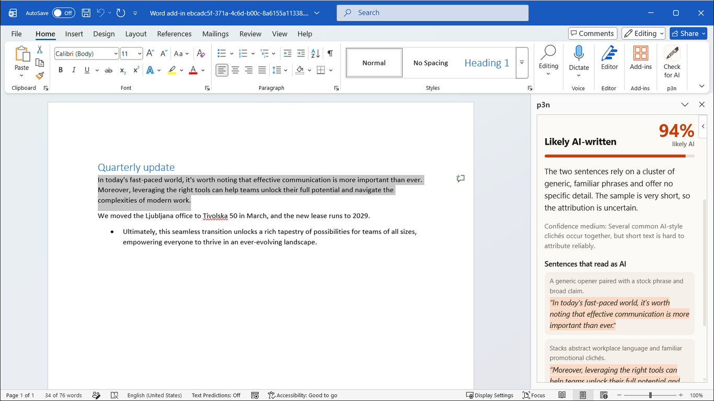
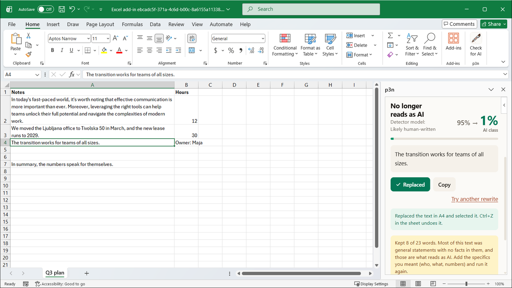

  

<h1 align="center">p3n for Word and Excel</h1>

  Select text in Word, or cells in Excel. See if it reads as AI-written, or rewrite it in place.

  <a href="#install">Install</a> · <a href="https://p3n.si">p3n.si</a> · <a href="https://nikita-andreiev.com/p3n/">All p3n apps</a>

  

## What it does

- **Check for AI.** A score, a one-line reason, and the sentences that give it away.
- **Rewrite.** A version that keeps your facts and drops the filler. **Replace** puts it back where it came from. In Word that's your selection, and each paragraph keeps its style. In Excel it's the cell. Ctrl+Z undoes it.
- Open it from **Check for AI** on the Home tab, or **Check with p3n** in the right-click menu.

## Free, or with a key

You get 10 checks or rewrites an hour without an account, up to 5,000 characters each. For more, [sign up at p3n.si](https://p3n.si/register) (you get free credit), make a key on the [API keys](https://p3n.si/dashboard/keys) page, and add it with **Add API key** at the top of the pane.

## Privacy

The add-in sends the text you chose to `api.p3n.si`, and only when you click. The add-in keeps no history and has no analytics. Your API key stays on your device and is never saved in a document. p3n.si keeps the text for up to 7 days. The details are in [PRIVACY.md](PRIVACY.md).

## Install

Until the AppSource listing is live, add it from its manifest, [manifest.xml](https://nikita-andreiev.com/p3n-office-addin/manifest.xml):

- **Word or Excel on the web:** Home › Add-ins › More Add-ins › My Add-ins › Upload My Add-in, then pick the file.
- **Windows:** put the file in a shared folder, add that folder as a trusted catalog, then find p3n under Shared Folder. [Microsoft's steps](https://learn.microsoft.com/office/dev/add-ins/testing/create-a-network-shared-folder-catalog-for-task-pane-and-content-add-ins).
- **Mac:** copy the file to `~/Library/Containers/com.microsoft.Word/Data/Documents/wef` (for Excel, `com.microsoft.Excel`), then restart the app.

The pane loads from GitHub Pages, so it updates by itself.

**Added it before 21 October 2026?** Add the manifest again. The pane moved from `barabosik.github.io` to `nikita-andreiev.com`, and the old manifest doesn't load it any more. On the web, remove p3n under My Add-ins first. On Windows and Mac, put the new file where the old one was and restart Word or Excel.

## Known gaps

Tested in Word and Excel for Windows (Microsoft 365). Mac and the web run the same code but haven't been tested. In Excel, Replace works on one cell at a time, and never over a formula.

## Other p3n apps

p3n also works in [Chrome and Firefox](https://nikita-andreiev.com/p3n/#browser), [Google Docs](https://nikita-andreiev.com/p3n/#docs), [VS Code](https://nikita-andreiev.com/p3n/#vscode), [Obsidian](https://nikita-andreiev.com/p3n/#obsidian) and [Sublime Text](https://nikita-andreiev.com/p3n/#sublime). Install steps for each are on [nikita-andreiev.com/p3n](https://nikita-andreiev.com/p3n/).

## Develop

Tests and running it locally are in [CONTRIBUTING.md](CONTRIBUTING.md).

## Licence

MIT
