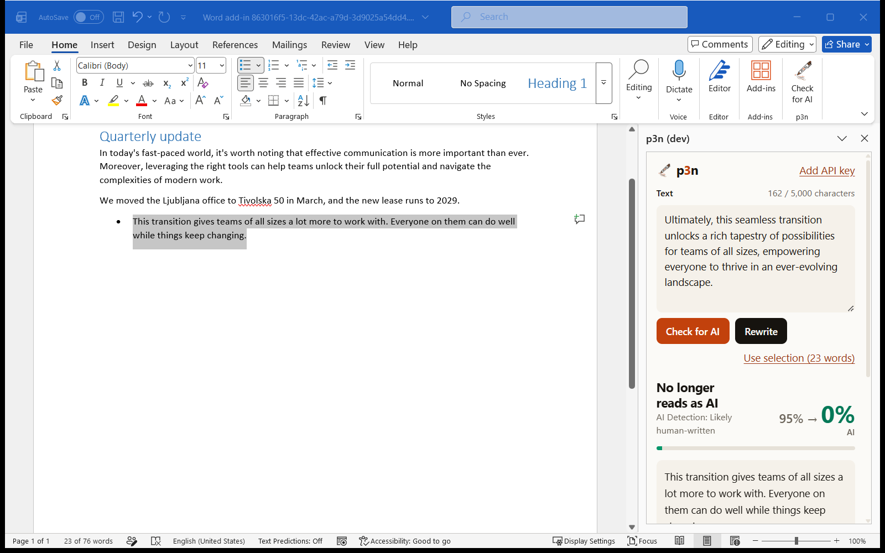

# p3n for Word

Select text in a Word document and see whether it reads as AI-written. Or rewrite it so it doesn't, and put the rewrite back in place of the original. A task pane, using the [p3n API](https://p3n.si/docs) (the same Check and Rewrite skills as p3n.si and the p3n Chrome extension).




Version 1.0.0. Not on Microsoft Marketplace (AppSource). For now it runs from a local dev server.

## Use

- **Home → Check for AI** (or right-click selected text → **Check with p3n**) opens the pane. If text is selected, it lands in the box. Nothing is sent yet.
- **Check for AI** shows how likely the text is AI-written and the sentences that read as AI. **Rewrite** rewrites it so it doesn't read as AI and shows the score before and after.
- **Use selection (N words)** takes whatever is selected now. With nothing selected it reads **Use whole document**. You can also type or paste text in the box.
- **Replace in document** puts the rewrite where the text came from. Ctrl+Z (Cmd+Z on a Mac) in the document undoes it. Replace keeps each paragraph's style (headings, list items, quotes) and never adds an empty paragraph. If the text changed in the document since you took it, Replace refuses and leaves it alone. It also won't paste over a table or a picture: use **Copy** for those.
- Text edited in the pane isn't the document's text any more, so Replace isn't offered for it: use **Copy**.
- **Try another rewrite** asks for a fresh one. Replace again swaps the first rewrite for the new one.

## API key

Without a key, p3n allows 10 calls an hour, up to 5,000 characters each. For more, sign up at [p3n.si](https://p3n.si/register), create a key on the [API keys](https://p3n.si/dashboard/keys) page, and paste it under **Add API key** in the pane. The key is checked with p3n (`GET /v1/me`) before it's saved, so a typo never replaces a good key. No login.

The key is stored in the pane's own browser storage (`localStorage`) on this device, per user. It's never saved in the document's settings, so it doesn't travel inside a .docx you share. (`OfficeRuntime.storage` would need a shared runtime, which this add-in doesn't use.)

## What it sends

Only the text you choose, and only when you click Check or Rewrite. It goes to `api.p3n.si` and nowhere else; the pane's content security policy allows no other connection. The pane reads your selection locally to count its words for the **Use selection** link. It keeps no history and has no analytics. Office.js (Microsoft's library, from Microsoft's CDN) talks to Word directly. In the runs in Word it tried no network connection from the pane; the policy would have blocked and logged one.

## Permissions

The manifest asks for `ReadWriteDocument`: read the selection, and write the rewrite back on Replace. Nothing runs until you open the pane. There are no background functions; the ribbon and right-click buttons only open the pane.

## Manifest: add-in only XML, not the unified JSON manifest

`manifest.xml` is the add-in only manifest (XML). Microsoft's docs ([manifest overview](https://learn.microsoft.com/en-us/office/dev/add-ins/develop/add-in-manifests), [unified manifest overview](https://learn.microsoft.com/en-us/office/dev/add-ins/develop/unified-manifest-overview), updated 2026-10-14) say:

- The XML manifest is supported for production Word add-ins on every platform that runs add-ins: Windows (Microsoft 365 and perpetual versions), Mac, iPad and the web.
- The unified manifest works for Word on the web, on Windows from Version 2501 (build 18407.20002) with a Microsoft 365 subscription, and on Mac from 16.103. It does **not** work on perpetual Office for Windows or on mobile. Microsoft's advice for reaching those users is to ship both manifests.
- The unified manifest's gain is packaging one app for Microsoft 365 that combines add-ins and Teams or Copilot extensions. p3n for Word needs none of that.

So XML reaches everyone with one file. Microsoft's validator (`npm run validate`) lists Word 2019 or later on Windows, Microsoft 365 on Windows and Mac, Word 2016 or later on Mac, the web and iPad. Going unified later is a conversion with Microsoft's `npx office-addin-project convert`, kept next to the XML file, not a rewrite.

Word API: `WordApi 1.3` (selection, paragraphs, tracked ranges, `intersectWithOrNullObject`). Office.js loads from Microsoft's CDN, `https://appsforoffice.microsoft.com/lib/1/hosted/office.js`.

## Develop

Needs Node 20 or later and Word desktop.

```bash
npm install
```

The pane must be served over HTTPS from the domain the manifest names. For development that's `https://localhost:3000`, with a certificate from Microsoft's `office-addin-dev-certs`. Install it once:

```bash
npx office-addin-dev-certs install
```

This makes a local certificate authority in `~/.office-addin-dev-certs` and adds it to your Windows user's trusted roots. Windows asks you to confirm. `npx office-addin-dev-certs uninstall` removes it.

### Sideload in Word on Windows

```bash
npm start
```

That runs Microsoft's `office-addin-debugging`: it starts `dev/server.mjs` (a static HTTPS server for `src/` on port 3000), registers `manifest.xml` for Word under `HKCU\Software\Microsoft\Office\16.0\WEF\Developer`, and opens Word with the pane. The add-in shows as **p3n (dev)**. When you're done:

```bash
npm run stop
```

`npm run stop` removes the registration and stops the server. Closing Word alone leaves the registration behind.

To serve without sideloading (for example after `npm run stop` left Word open), run `npm run serve`. To sideload by hand instead, use a [shared-folder catalog](https://learn.microsoft.com/en-us/office/dev/add-ins/testing/create-a-network-shared-folder-catalog-for-task-pane-and-content-add-ins) holding `manifest.xml`.

### Word on the web and Mac

On the web: while `npm run serve` runs on the same machine, open a document, choose **Home → Add-ins → More Settings → Upload My Add-in**, and pick `manifest.xml`. On a Mac, copy `manifest.xml` to `~/Library/Containers/com.microsoft.Word/Data/Documents/wef`. Neither has been tried yet; see [Tests](#tests).

## Tests

`dev/` isn't part of the add-in.

**Headless, every run** (`npm run e2e`): opens the pane in headless Chrome with `dev/office-stub.js` in place of Office.js. The stub is a small Word: one document with paragraph styles, live ranges that move with edits, and Word's rules that a property is readable only after `load()` and `sync()`, and that a range is reusable in a later `Word.run` only if it was tracked. The API answers with canned runs, so no free calls are spent. 41 checks:

- the selection arrives when the pane opens, and nothing is sent before a click;
- Check and Rewrite render (score count, highlighter, rewrite wipe), and reduced motion shows the end state at once;
- Replace: the rewrite lands in place, the other paragraphs and every style stay, no paragraph is added; it lands correctly after edits above it; it refuses when the text changed, over a table, and for text edited in the pane; a merged rewrite leaves no empty paragraph; a double-clicked word keeps its space;
- the whole document when nothing is selected; the 5,000-character limit without a key; the free-limit message; the API key check-then-save, Escape and focus; a result below the fold scrolls into view; no console errors, and no request to anything but `api.p3n.si`.

`LIVE=1 npm run e2e` runs Check and Rewrite against the live API instead (2 of the 10 free calls an hour). `ONLY=replace,moved` runs some scenarios.

**In Word** (`node dev/word-live.mjs`, with Word closed):
- How it works: it sideloads with `office-addin-debugging`, and starts Word with `WEBVIEW2_ADDITIONAL_BROWSER_ARGUMENTS=--remote-debugging-port=9229` so the real pane can be driven over that port. It writes a test document through Word's COM interface.
- What it checks: Use selection, Check and Rewrite against the live API (2 free calls), Replace on a bulleted list paragraph, and undo.
- `MOCK=1` answers with canned runs and adds three cases: replacing three paragraphs at once (each keeps its style, one undo reverts all three), the changed-text refusal, and text that moved.
- Undo: a real Ctrl+Z keystroke when Word is the foreground window. If you're using another window at the time, it runs Word's Undo command instead (the command Ctrl+Z triggers) and says which it used. Keys never go to another window.
- Screenshots: of Word's own window (PrintWindow), saved to `dev/out/`.

Results on 2026-10-20, Word for Microsoft 365 on Windows 11, build 16.0.20430.20182:
- live API: 13/13 pass, including a real Ctrl+Z keystroke undoing the Replace in one step;
- `MOCK=1`: all cases pass; the three-paragraph Replace also undoes in one step.

Word's host script (`word-win32-16.01.js`) sets inline styles while it loads, so the pane's content security policy allows inline styles. Scripts and connections stay locked down.

Not tested: Word on the web (needs a Microsoft sign-in in a browser) and Word on Mac.

## Files

| File | Does |
| --- | --- |
| `manifest.xml` | Development manifest (`https://localhost:3000`). A Home tab button and a right-click entry that open the pane. |
| `manifest.p3n.si.xml` | The same add-in served from `https://p3n.si/word/` (not live). |
| `src/taskpane.html`, `src/taskpane.js` | The pane: input, results, Replace, the API key view. Same rendering and motion as the Chrome extension. |
| `src/lib/word.js` | Word glue: read the selection or the document, keep a tracked range, replace paragraph by paragraph, refuse if the text changed. |
| `src/lib/api.js` | The API client (from the Chrome extension): `POST /v1/detect` and `/v1/humanize`, polls `/v1/runs/{id}` for long texts, readable errors. |
| `src/lib/store.js` | The API key in `localStorage`, and the free calls left this session. |
| `src/ui/` | The p3n.si colour and motion tokens, and the pane's styles. |
| `dev/server.mjs` | The HTTPS dev server. |
| `dev/e2e.mjs`, `dev/office-stub.js` | The headless test and its stand-in for Office.js. |
| `dev/word-live.mjs` | The run in real Word. |
